<a href="https://hareeshkar-portfolio-v2.vercel.app"><picture>
  <source media="(prefers-color-scheme: dark)" srcset="assets/header-dark.svg">
  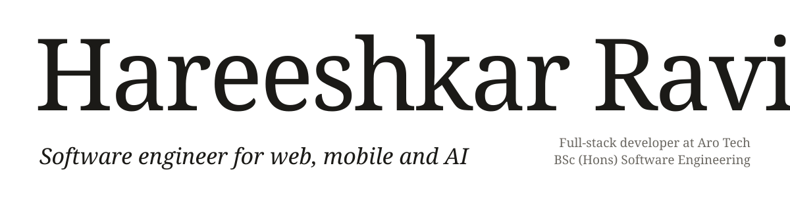
</picture></a>

<picture><source media="(prefers-color-scheme: dark)" srcset="assets/intro-dark.svg">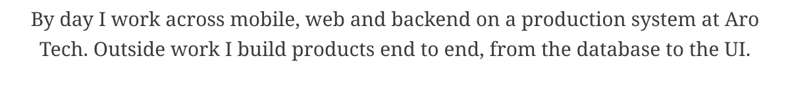</picture>

<a href="https://hareeshkar-portfolio-v2.vercel.app"><picture><source media="(prefers-color-scheme: dark)" srcset="assets/nav-portfolio-dark.svg"></picture></a>&nbsp;<a href="https://www.linkedin.com/in/hareeshkar-ravi/"><picture><source media="(prefers-color-scheme: dark)" srcset="assets/nav-linkedin-dark.svg"></picture></a>&nbsp;<a href="mailto:hareeshkarravi@gmail.com"><picture><source media="(prefers-color-scheme: dark)" srcset="assets/nav-email-dark.svg"></picture></a>

  

<picture><source media="(prefers-color-scheme: dark)" srcset="assets/h-work-dark.svg"></picture>

<a href="https://github.com/hareeshkar/PCA_CinemaX"><picture><source media="(prefers-color-scheme: dark)" srcset="assets/p-cinemax-dark.svg">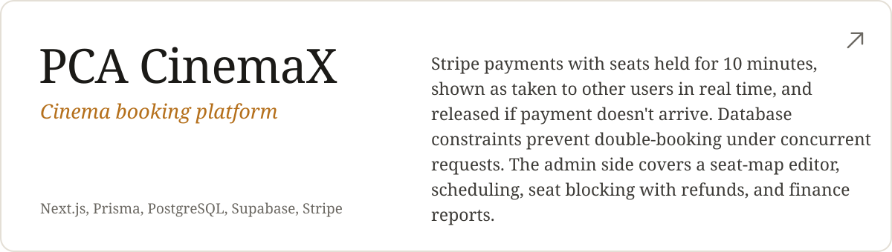</picture></a>

 

<a href="https://github.com/hareeshkar/wasi-kapruka"><picture><source media="(prefers-color-scheme: dark)" srcset="assets/p-wasi-dark.svg">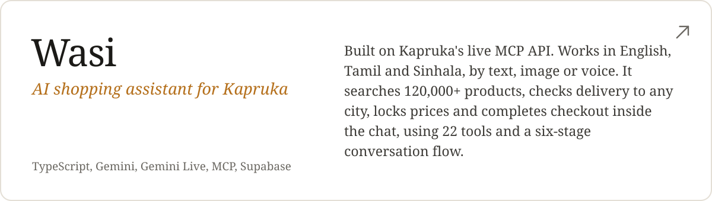</picture></a>

<a href="https://github.com/hareeshkar/wasi-kapruka"><picture><source media="(prefers-color-scheme: dark)" srcset="assets/b-code-dark.svg"></picture></a>&nbsp;<a href="https://wasi-etpz.onrender.com"><picture><source media="(prefers-color-scheme: dark)" srcset="assets/b-demo-dark.svg"></picture></a>

 

<a href="https://github.com/hareeshkar/project-argus-final"><picture><source media="(prefers-color-scheme: dark)" srcset="assets/p-argus-dark.svg">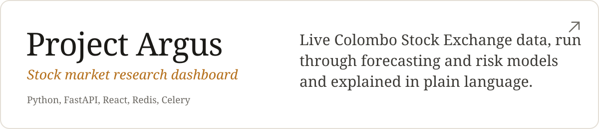</picture></a>

 

<a href="https://github.com/hareeshkar/cse-mcp-intelligence"><picture><source media="(prefers-color-scheme: dark)" srcset="assets/p-csemcp-dark.svg">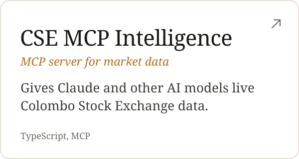</picture></a><a href="https://github.com/hareeshkar/ClinicalSimulator"><picture><source media="(prefers-color-scheme: dark)" srcset="assets/p-clinical-dark.svg">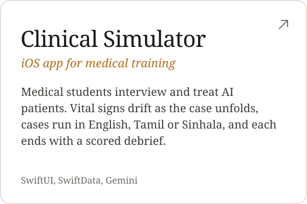</picture></a>

<a href="https://github.com/hareeshkar/synapse-med"><picture><source media="(prefers-color-scheme: dark)" srcset="assets/p-synapse-dark.svg">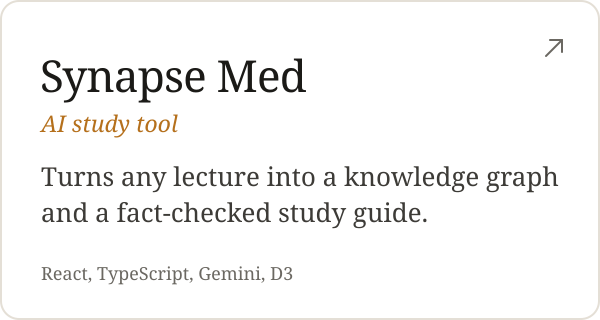</picture></a><a href="https://github.com/hareeshkar/physiobrain-ai"><picture><source media="(prefers-color-scheme: dark)" srcset="assets/p-physio-dark.svg">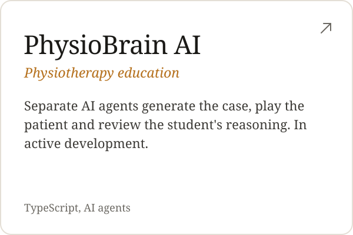</picture></a>

<a href="https://hareeshkar.github.io/synapse-med/">Synapse Med live demo</a> &nbsp;&nbsp; <a href="https://physiobrain-ai.vercel.app">PhysioBrain AI live demo</a>

  

<picture><source media="(prefers-color-scheme: dark)" srcset="assets/h-oss-dark.svg">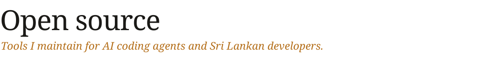</picture>

<a href="https://github.com/hareeshkar/opencode-advisor"><picture><source media="(prefers-color-scheme: dark)" srcset="assets/o-advisor-dark.svg">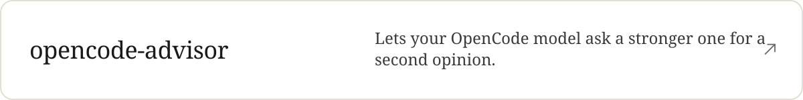</picture></a>

<a href="https://github.com/hareeshkar/opencode-subagent-delegate"><picture><source media="(prefers-color-scheme: dark)" srcset="assets/o-delegate-dark.svg">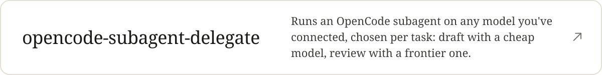</picture></a>

<a href="https://github.com/hareeshkar/sri-lanka-postal-locations"><picture><source media="(prefers-color-scheme: dark)" srcset="assets/o-postal-dark.svg">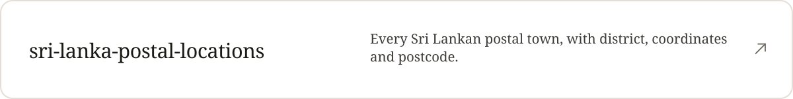</picture></a>

  

<picture><source media="(prefers-color-scheme: dark)" srcset="assets/h-stack-dark.svg"></picture>

<picture>
  <source media="(prefers-color-scheme: dark)" srcset="assets/stack-dark.svg">
  
</picture>

  

<a href="mailto:hareeshkarravi@gmail.com"><picture><source media="(prefers-color-scheme: dark)" srcset="assets/footer-dark.svg"></picture></a>

More work in <a href="https://github.com/hareeshkar?tab=repositories">all repositories</a>.
