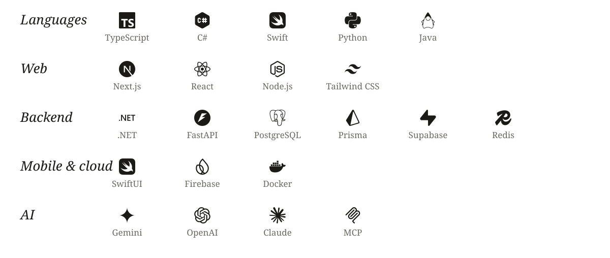

<picture>
  <source media="(prefers-color-scheme: dark)" srcset="assets/header-dark.svg">
  
</picture>

 
 

By day I work across mobile, web and backend on a production system at Aro Tech. Outside work I build products end to end, from the database to the UI. A few of them are below.

[Portfolio](https://hareeshkar-portfolio-v2.vercel.app) &nbsp;&nbsp; [LinkedIn](https://www.linkedin.com/in/hareeshkar-ravi/) &nbsp;&nbsp; [Email](mailto:hareeshkarravi@gmail.com)

 

## Booking and commerce

### [PCA CinemaX](https://github.com/hareeshkar/PCA_CinemaX)

Cinema booking platform with Stripe payments. Confirmed seats are held for 10 minutes, shown as taken to other users in real time, and released if payment doesn't arrive. Database constraints prevent double-booking under concurrent requests. The admin side covers a seat-map editor, scheduling, seat blocking with refunds, and finance reports.

Next.js, Prisma, PostgreSQL, Supabase, Stripe

### [Wasi](https://github.com/hareeshkar/wasi-kapruka)

AI shopping assistant for Kapruka, built on its live MCP API. Works in English, Tamil and Sinhala, by text, image or voice. It searches 120,000+ products, checks delivery to any city, locks prices and completes checkout inside the chat, using 22 tools and a six-stage conversation flow. [Try the live demo](https://wasi-etpz.onrender.com).

TypeScript, Gemini, Gemini Live, MCP, Supabase

 

## Stock market analytics

### [Project Argus](https://github.com/hareeshkar/project-argus-final)

Research dashboard for Colombo Stock Exchange stocks. It pulls live prices, order books and trade ticks, runs ARIMA forecasting, EWMA value-at-risk, drawdown, anomaly and regime models, combines them into one signal, and explains the result in plain language.

Python, FastAPI, React, Redis, Celery

### [CSE MCP Intelligence](https://github.com/hareeshkar/cse-mcp-intelligence)

The same market data, made available to AI agents. An MCP server that lets Claude and other models look up live prices, sector performance, order-flow pressure and company fundamentals on their own.

TypeScript, MCP

 

## Medical education

### [Clinical Simulator](https://github.com/hareeshkar/ClinicalSimulator)

An iOS app where medical students interview and treat AI patients. Vital signs drift as the case unfolds, every case runs in English, Tamil or Sinhala, and each session ends with a scored debrief matched to the learner's level.

SwiftUI, SwiftData, Gemini

### [Synapse Med](https://github.com/hareeshkar/synapse-med)

Upload a lecture as a PDF, image or recording and get back an interactive knowledge graph and a study guide with sources checked against Google Search. [Try the live demo](https://hareeshkar.github.io/synapse-med/).

React, TypeScript, Gemini, D3

### [PhysioBrain AI](https://github.com/hareeshkar/physiobrain-ai)

Practice platform for physiotherapy students. Separate AI agents generate the case, play the patient and review the student's reasoning. Still in active development. [Try the live demo](https://physiobrain-ai.vercel.app).

TypeScript, AI agents

 

## Open source

**[opencode-advisor](https://github.com/hareeshkar/opencode-advisor)** lets the model doing your work in OpenCode stop and ask a stronger model for a second opinion, within a token budget you set.

**[opencode-subagent-delegate](https://github.com/hareeshkar/opencode-subagent-delegate)** runs an OpenCode subagent on any model you've connected, chosen per task: draft with a cheap model, review with a frontier one.

**[sri-lanka-postal-locations](https://github.com/hareeshkar/sri-lanka-postal-locations)** is every Sri Lankan province, district and postal town in one linked dataset, with coordinates and postcodes, ready for address forms. No dependencies.

 

## What I work with

<picture>
  <source media="(prefers-color-scheme: dark)" srcset="assets/stack-dark.svg">
  
</picture>

 

More work in [all repositories](https://github.com/hareeshkar?tab=repositories).
